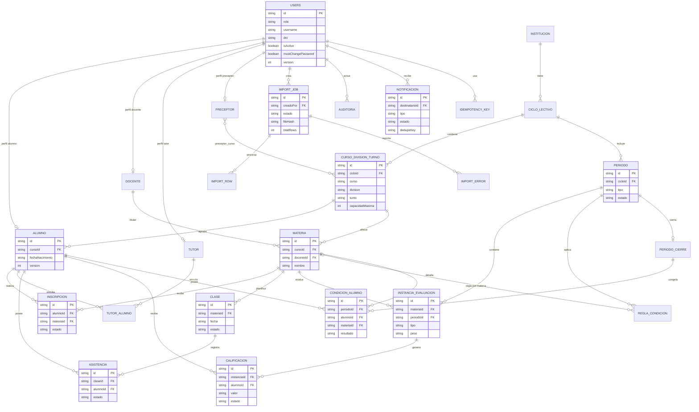

# Modelo de dominio

Este documento describe las entidades principales del backend, organizadas por contexto. Las clases con comportamiento viven en `src/domain/**`; los repositorios y mappers de `src/infra/db` solo traducen esas estructuras a PostgreSQL.

## Convenciones

- **Entidad / agregado**: objeto con identidad y reglas de negocio encapsuladas en sus métodos.
- **Registro / snapshot**: concepto inmutable o de solo lectura que conserva un hecho ya ocurrido (auditoría, cierre de período, condición calculada).
- **Versión**: casi todas las entidades mutables tienen `version`; la persistencia usa concurrencia optimista y lanza `StaleVersionError` si cambió otra transacción (`src/domain/shared/value-objects.ts:129`).

## Mapa de relaciones

- `Institucion` 1 → N `CicloLectivo` 1 → N `CursoDivisionTurno`.
- `User` 1 → 0..1 perfil (`Alumno`, `Docente`, `Tutor`, `Preceptor`); el rol en `User` discrimina cuál aplica.
- `Preceptor` N ↔ N `CursoDivisionTurno` mediante la tabla puente `preceptor_curso` (no es entidad de dominio).
- `CursoDivisionTurno` 1 → N `Materia`; `Docente` 1 → N `Materia` como titular.
- `Alumno` N ↔ N `Materia` mediante `Inscripcion`.
- `Tutor` N ↔ N `Alumno` mediante `TutorAlumno`.
- `Materia` 1 → N `Clase` 1 → N `Asistencia`; cada `Asistencia` también pertenece a un `Alumno`.
- `CicloLectivo` 1 → N `Periodo` 1 → N `InstanciaEvaluacion` 1 → N `Calificacion`.
- `Periodo` 1 → N `ReglaCondicion` y 1 → 0..1 `PeriodoCierre`; el cierre congela N `CondicionAlumno`.
- `User` (administrador) 1 → N `ImportJob` 1 → N filas y errores de staging.
- `RegistroAuditoria`, `IdempotencyKey` y `Notificacion` son conceptos transversales vinculados al actor/operación.
## Diagrama entidad-relación

El diagrama muestra los agregados principales y sus cardinalidades. Las tablas puente y los tokens de refresh son artefactos de persistencia: `preceptor_curso` aparece como relación y `RefreshToken` se omite por no ser una entidad de dominio.

## Identidad

Fuente: `src/domain/identity/entities.ts`.

| Entidad | Responsabilidad | Reglas principales |
|---|---|---|
| `User` (:27) | Cuenta autenticable: datos personales, credenciales, rol y estado de acceso. | `canAuthenticate()` exige activo, username y hash; `mustChangePassword` restringe el acceso a cambio de contraseña; `activate/deactivate`; normalización de DNI, username y email. |
| `Alumno` (:134) | Perfil del estudiante dentro de un curso/división/turno. | Valida fecha de nacimiento; `changeCourse()` reasigna curso; `belongsToCourse()` comprueba pertenencia. |
| `Docente` (:178) | Perfil docente con datos laborales y curso de referencia opcional. | `changePhone()` y `changeHireDate()` validan datos; `changeReferenceCourse()` acepta `null`. |
| `Tutor` (:224) | Perfil del responsable de uno o más alumnos. | `changePhone()` valida y normaliza el teléfono. |
| `Preceptor` (:258) | Perfil operativo con uno o más cursos asignados. | `canOperate()` exige al menos un curso; copias defensivas de `courseIds`. |
| `TutorAlumno` (:305) | Vínculo tutor-alumno con código institucional de alta. | `isCodeUsable()` exige vínculo activo, registro pendiente y código no expirado; `register()` marca el alta; `deactivate()` lo desactiva. |

## Académico

Fuente: `src/domain/academic/entities.ts`.

| Entidad | Responsabilidad | Reglas principales |
|---|---|---|
| `Institucion` (:27) | Datos de la institución educativa (CUE, contacto, estado). | `activate()` / `deactivate()`. |
| `CicloLectivo` (:74) | Año lectivo y su ventana temporal. | Estados `planificado|activo|cerrado`; `contains(date)`; no se puede activar un ciclo cerrado; `close()` es idempotente. |
| `CursoDivisionTurno` (:128) | Curso/división/turno de un ciclo, con cupo máximo. | `changeCapacity()` impide reducir el cupo por debajo de los alumnos actuales; `displayName()`. |
| `Materia` (:174) | Asignatura de un curso, con docente titular. | Renombrar/describir exige valores no vacíos; `assignTeacher()` y `changeCourse()` reasignan referencias. |
| `Inscripcion` (:222) | Alta de un alumno en una materia y su estado. | Estados `pendiente|aprobado|rechazado|cancelado`; `approve()` y `reject()` solo desde `pendiente`; `cancel()` idempotente salvo si ya está rechazada. |
| `Clase` (:278) | Encuentro de clase de una materia con fecha, horario, tema y estado. | Valida rango horario (fin > inicio, máximo 8 h); transiciones `programada|dictada|cancelada`; `canRegisterAttendance()` solo si está `dictada`. |

## Asistencia

Fuente: `src/domain/attendance/entities.ts`.

| Entidad | Responsabilidad | Reglas principales |
|---|---|---|
| `Asistencia` (:15) | Registro de la asistencia de un alumno a una clase. | Estados `presente|ausente|justificada|tarde`; `justify()` solo permite justificar una ausencia y exige texto; otros estados limpian la justificación. |

## Evaluación y condición académica

Fuente: `src/domain/grading/entities.ts`.

| Entidad | Responsabilidad | Reglas principales |
|---|---|---|
| `Periodo` (:31) | Ventana de evaluación dentro del ciclo (`trimestre|cuatrimestre`). | `assertOpen()` bloquea escrituras si está `cerrado`; `close()` idempotente. |
| `InstanciaEvaluacion` (:86) | Evaluación planificada de una materia en un período. | Tipo `parcial|tp|oral|recuperatorio|otro`; `changeWeight()` exige peso > 0, 0–100 y hasta 2 decimales. |
| `Calificacion` (:143) | Nota de un alumno y su ciclo de vida. | Estados `activa|rectificada|anulada`; notas 0–10; `annul()`, `rectify()` y `replaceAnnulled()` exigen motivo; la rectificación es administrador. |
| `ReglaCondicion` (:251) | Parámetros de condición por período, opcionalmente por materia. | Configuración de asistencia mínima y notas de regularidad/promoción. |
| `CondicionAlumno` (:293) | Snapshot calculado de la condición del alumno. | Resultado `regular|libre|promocionado|no_aplica`, promedio y porcentaje de asistencia; se congela al cerrar el período. |
| `PeriodoCierre` (:346) | Registro de la ejecución del cierre de un período. | Guarda ejecutor, fecha, totales y resumen; relación 1:1 con `Periodo`. |

La regla pura `calculateCondition()` (:394) pondera notas activas/rectificadas, calcula asistencia sobre clases dictadas y aplica los umbrales de la regla.

## Importación de alumnos

Fuente: `src/domain/imports/entities.ts` y `src/domain/imports/alumnos-csv.ts`.

| Elemento | Responsabilidad | Reglas principales |
|---|---|---|
| `ImportJob` (:26) | Representa el trabajo de importación masiva y su progreso. | Estados `pendiente|procesando|completada|fallida`; contadores de filas, hash del CSV, token/lease/heartbeat del worker. Las transiciones se orquestan en `application/imports-service.ts` y `infra/imports/import-worker.ts`. |
| `ImportRowProps` (:96) | Estructura de la fila intermedia de staging. | Estados `pendiente|valida|invalida`. |
| `ImportErrorProps` (:102) | Error estructurado por fila/columna. | Código, mensaje y valor crudo; se expone en `/imports/:id/errores`. |
| `validateAlumnoRow()` (:95) | Valida y normaliza cada fila del CSV. | Campos obligatorios, DNI, fecha no futura, curso 1–7, división A–Z, turno, relación y teléfono; exige `otra_relacion` cuando corresponde; rechaza DNI alumno = DNI tutor; detecta duplicados dentro del archivo. |

## Conceptos transversales

| Concepto | Responsabilidad | Fuente |
|---|---|---|
| `RegistroAuditoria` | Evento append-only con entidad, acción, actor/rol, antes/después y `requestId`. | `src/domain/audit/entities.ts:27` |
| `IdempotencyKey` | Evita repetir operaciones con la misma clave; guarda estado y respuesta. | `src/domain/idempotency/entities.ts:17` |
| `Notificacion` | Mensaje diferido al tutor con estado, reintentos y `dedupeKey`. | `src/domain/notifications/entities.ts:17` |
| `RefreshToken` | Registro de sesión renovable; es un contrato del puerto, no una entidad con comportamiento. | `src/domain/identity/ports.ts:72` |

## Detalle de contextos transversales

### Auditoría

- **Responsabilidad**: conservar un registro inmutable de las operaciones sensibles: qué entidad se afectó, qué acción se ejecutó, quién la ejecutó y qué cambió.
- **Componentes**: entidad `RegistroAuditoria` (`src/domain/audit/entities.ts:27`), `AuditoriaRepository`, servicio `src/application/audit-service.ts` y tabla `auditoria` (`src/infra/db/migrations/1700000000000_initial.sql:370`).
- **Datos**: `entidad`, `entidad_id`, `accion`, `actor_id`, `actor_rol`, `motivo`, `antes`, `despues`, `request_id` y `ocurrido_en`.
- **Reglas**: solo se agrega; un trigger de BD impide `UPDATE` y `DELETE`. El administrador ve todas las entradas desde `GET /api/v1/auditoria`; los demás roles solo las que tienen `actor_id = self`. El historial de calificaciones (`GET /calificaciones/:id/historial`) consume estas mismas entradas filtradas por entidad.

### Idempotencia

- **Responsabilidad**: evitar que un reintento de red ejecute dos veces una operación de mutación.
- **Componentes**: entidad `IdempotencyKey` (`src/domain/idempotency/entities.ts:17`), middleware en `src/infra/http/middleware.ts:179`, `IdempotencyRepository` y tabla `idempotency_keys` (:414).
- **Reglas**: el header `Idempotency-Key` es obligatorio en altas, cambios y bajas; la clave se asocia al actor, al alcance de la ruta y al hash del pedido. Un replay idéntico devuelve la respuesta guardada con `Idempotent-Replayed: true`; si la clave ya se usó con otro pedido se rechaza. Las respuestas no 2xx liberan la clave y el TTL por defecto es 24 h.
- **Caso especial**: en `POST /imports/alumnos` la clave se complementa con el hash del CSV para no repetir una importación con otro archivo.
- **Errores**: `IDEMPOTENCY_KEY_REQUIRED` (400) y `IDEMPOTENCY_KEY_REUSED` (409).

### Importaciones

- **Responsabilidad**: procesar altas masivas de alumnos, tutores y vínculos desde un CSV de forma asíncrona, con validación por fila y trazabilidad del job.
- **Componentes**: `ImportJob`, `ImportRowProps`, `ImportErrorProps` (`src/domain/imports/entities.ts`), reglas de CSV (`src/domain/imports/alumnos-csv.ts`), orquestación en `src/application/imports-service.ts` y ejecución en `src/infra/imports/import-worker.ts`.
- **Flujo**: (1) validación de permiso de administrador, tamaño y headers; (2) creación del job `pendiente` con hash del archivo; (3) claim con lease y heartbeat; (4) parseo/validación por lotes; (5) inserción de alumnos/tutores/vínculos e inscripciones; (6) cierre en `completada` o `fallida` con contadores y errores.
- **Estados y transiciones**: ver la sección *Estados y transiciones → Importación (transiciones)*.
- **Persistencia**: `import_jobs`, `import_rows` y `import_errors`. Solo existe un job activo por creador; los jobs terminales se eliminan por retención.
- **Endpoints**: `POST /api/v1/imports/alumnos`, `GET /api/v1/imports/:id` y `GET /api/v1/imports/:id/errores`, con límite propio `IMPORT_RATE_LIMIT_MAX`.

### Notificaciones

- **Responsabilidad**: diferir y reintentar avisos a tutores ante ausencias, cambios de calificación y cierres de período.
- **Componentes**: entidad `Notificacion` (`src/domain/notifications/entities.ts:17`), puerto `Notifier`, repositorio `src/infra/db/repositories/notifications.ts` y tabla `notificaciones` (:493).
- **Datos**: destinatario, tipo, payload, estado, `intentos`, `next_attempt_at`, `last_error`, `dedupe_key` y timestamps.
- **Reglas**: `dedupeKey` evita duplicados; `claimBatch()` solo toma pendientes con `next_attempt_at <= now()` e incrementa `intentos`; `markSent()` pasa a `enviada`; `markFailed()` vuelve a `pendiente` si hubo menos de 3 intentos y pasa a `fallida` al agotarlos. El reintento se programa 60 s después.
- **Disparadores**: registrar una ausencia, crear/actualizar/anular/rectificar calificaciones y cerrar un período.
- **Estados y transiciones**: ver la sección *Estados y transiciones → Notificación*. No hay endpoint HTTP de lectura en este repositorio.

## Tipos y reglas compartidas

- Roles: `administrador|preceptor|docente|alumno|tutor` (`src/domain/shared/types.ts:27`).
- Estados de inscripción, asistencia, clase, período, evaluación, calificación, condición e importación: `src/domain/shared/types.ts:30-52`.
- Validadores reutilizables: email, DNI (7–8 dígitos), username, password, fechas/horas, `parseGrade()` (0–10), `parsePercentage()` (0–100), `assertVersion()` y redondeo half-up (`src/domain/shared/value-objects.ts`).
- Errores de dominio con código semántico/HTTP: `src/domain/shared/errors.ts` (por ejemplo `StaleVersionError`, `PeriodClosedError`, `ImportAlreadyRunningError`).

## Invariantes y reglas de negocio por entidad

Esta sección detalla qué debe permanecer verdadero antes y después de cada mutación. Los códigos entre backticks son errores de dominio definidos en `src/domain/shared/errors.ts`; cuando la regla se refuerza con una restricción SQL, se indica expresamente.

### Identidad

| Entidad | Invariantes | Reglas / transiciones | Error al violar |
|---|---|---|---|
| `User` | `username` y `passwordHash` son necesarios para autenticar; `isActive` habilita el acceso; `role` pertenece a `USER_ROLES`; `version` incrementa por mutación. | `canAuthenticate()` exige activo + credenciales; `changePassword(hash, mustChangePassword)` actualiza ambos a la vez; `activate/deactivate` cambia el estado; `rename` exige nombres no vacíos ≤ 100. | `VALIDATION_ERROR`; `PASSWORD_CHANGE_REQUIRED` se aplica en la capa HTTP mientras el flag esté activo. |
| `Alumno` | Existe un `User` con rol `alumno`; `cursoDivisionTurnoId` referencia un curso válido; `fechaNacimiento` es una fecha válida y no futura. | `changeBirthDate()` normaliza la fecha; `changeCourse()` reasigna el curso; `belongsToCourse()` comprueba pertenencia. | `VALIDATION_ERROR`. |
| `Docente` | Perfil de un `User` con rol `docente`; `telefono` no vacío ≤ 20; `fechaIngreso` válida; `cursoDivisionTurnoId` es opcional. | `changePhone()`, `changeHireDate()` y `changeReferenceCourse()` validan y normalizan; el curso de referencia puede limpiarse con `null`. | `VALIDATION_ERROR`. |
| `Tutor` | Perfil de un `User` con rol `tutor`; `telefono` no vacío ≤ 20. | `changePhone()` normaliza el valor. | `VALIDATION_ERROR`. |
| `Preceptor` | Perfil de un `User` con rol `preceptor`; `courseIds` se expone como copia; `canOperate()` exige al menos un curso asignado. | Las altas/cambios reemplazan la lista de cursos en la tabla puente `preceptor_curso`. | Operación bloqueada si `canOperate()` es falso; `VALIDATION_ERROR` en datos inválidos. |
| `TutorAlumno` | Par `(alumnoId, tutorId)` único; `relacion` es `padre|madre|otra`; si es `otra`, requiere `otraRelacion`; el código tiene expiración. | `isCodeUsable(now)` exige `activa`, `estadoRegistro='pendiente'` y no expirado; `register(at)` falla si ya está registrado; `deactivate()` desactiva el vínculo. | `INVALID_CODE`; `VALIDATION_ERROR`; `DUPLICATE_RESOURCE` en la unicidad SQL. |

### Académico

| Entidad | Invariantes | Reglas / transiciones | Error al violar |
|---|---|---|---|
| `Institucion` | CUE y datos de contacto válidos; `activa` define disponibilidad. | `activate()` / `deactivate()`. | `VALIDATION_ERROR`. |
| `CicloLectivo` | `año` y rango `fechaInicio <= fechaFin`; estado `planificado|activo|cerrado`. | `contains(date)` comprueba ventana; `activate()` prohíbe activar un ciclo cerrado; `close()` es idempotente. | `VALIDATION_ERROR`; `INVALID_STATE_TRANSITION`. |
| `CursoDivisionTurno` | Único por `(ciclo, curso, división, turno)` en BD; `turno` es `Mañana|Tarde`; `capacidadMaxima >= alumnos actuales`. | `changeCapacity(capacidad, alumnosActuales)` rechaza reducir por debajo de la ocupación; `displayName()` deriva el nombre. | `VALIDATION_ERROR` en dominio; `CAPACITY_EXCEEDED` al inscribir sin cupo. |
| `Materia` | `nombre` y `descripcion` no vacíos; pertenece a un curso; `docenteId` referencia un docente. | `rename()`, `changeDescription()`, `assignTeacher()` y `changeCourse()` validan longitudes y reasignan referencias. | `VALIDATION_ERROR`. |
| `Inscripcion` | Estado `pendiente|aprobado|rechazado|cancelado`; única activa por `(alumno, materia)` en BD. | `approve()` y `reject()` solo desde `pendiente`; `cancel()` está prohibida si ya está `rechazado` y es idempotente si ya está cancelada. | `INVALID_STATE_TRANSITION`; `DUPLICATE_RESOURCE`. |
| `Clase` | `fin > inicio`, duración ≤ 8 h; estado `programada|dictada|cancelada`; única por `(materia, fecha, horaInicio)` en BD. | `updateSchedule()` revalida horario; `markTaught()` no permite pasar desde `cancelada`; `cancel()` no permite desde `dictada`; `canRegisterAttendance()` solo en `dictada`. | `VALIDATION_ERROR`; `INVALID_STATE_TRANSITION`. |

### Asistencia

| Entidad | Invariantes | Reglas / transiciones | Error al violar |
|---|---|---|---|
| `Asistencia` | Estado `presente|ausente|justificada|tarde`; única por `(clase, alumno)` en BD; la clase debe estar `dictada`. | `changeStatus()` exige texto para `justificada` (≤ 500) y limpia la justificación en los demás estados; `justify()` solo funciona sobre `ausente` y cambia el estado a `justificada`. | `VALIDATION_ERROR`; `INVALID_STATE_TRANSITION`; `DUPLICATE_RESOURCE`. |

### Evaluación y condición

| Entidad | Invariantes | Reglas / transiciones | Error al violar |
|---|---|---|---|
| `Periodo` | Tipo `trimestre|cuatrimestre`; estado `abierto|cerrado`; rango de fechas dentro del ciclo. | `assertOpen()` bloquea escrituras; `close()` es idempotente; el cierre genera notificaciones y snapshots. | `PERIOD_CLOSED`; `INVALID_STATE_TRANSITION`. |
| `InstanciaEvaluacion` | Tipo `parcial|tp|oral|recuperatorio|otro`; `peso > 0`, ≤ 100 y ≤ 2 decimales; pertenece a materia y período. | `changeWeight()` valida el porcentaje; crear/actualizar está prohibido con período cerrado. | `VALIDATION_ERROR`; `PERIOD_CLOSED`. |
| `Calificacion` | Valor 0–10 con ≤ 2 decimales; estado `activa|rectificada|anulada`; única por `(instancia, alumno)` en BD. | `annul()`, `rectify()` y `replaceAnnulled()` exigen motivo; `changeValue()` no altera una nota anulada; `replaceAnnulled()` solo desde `anulada`; la rectificación es exclusiva de administrador en aplicación. | `VALIDATION_ERROR`; `INVALID_STATE_TRANSITION`. |
| `ReglaCondicion` | Umbrales de asistencia y notas válidos; única activa por período o por `(período, materia)` en BD. | `calculateCondition()` usa la regla de materia si existe, si no la general. | `VALIDATION_ERROR`; `DUPLICATE_RESOURCE`. |
| `CondicionAlumno` | Única por `(período, alumno, materia)` en BD; resultado `regular|libre|promocionado|no_aplica`. | Snapshot inmutable tras el cálculo/cierre; se recalcula antes de cerrar y se congela con `PeriodoCierre`. | `PERIOD_INCOMPLETE` si faltan datos para calcular. |
| `PeriodoCierre` | Relación 1:1 con `Periodo`; guarda ejecutor, fecha, totales y resumen. | Solo se crea a partir de un cierre completo; es un registro inmutable. | `PERIOD_INCOMPLETE`; `CONFLICT`. |

La función `calculateCondition()` aplica este orden: sin clases dictadas o sin promedio → `no_aplica`; asistencia por debajo del mínimo → `libre`; promedio ≥ umbral de promoción → `promocionado`; promedio ≥ umbral de regularidad → `regular`; en caso contrario → `libre`.

### Importación

| Entidad | Invariantes | Reglas / transiciones | Error al violar |
|---|---|---|---|
| `ImportJob` | Estado `pendiente|procesando|completada|fallida`; un job activo por administrador creador en BD; hash/ruta identifican el CSV. | `claim()`, `heartbeat()` y `recover()` gestionan propiedad del worker mediante lease; la finalización fija contadores y estado terminal. | `IMPORT_ALREADY_RUNNING`; `IMPORT_INVALID_FILE`; `PAYLOAD_TOO_LARGE`. |
| `ImportRowProps` / `ImportErrorProps` | `rowNumber > 0`; estado de fila `pendiente|valida|invalida`; el error conserva fila, columna, código, mensaje y valor crudo. | Los errores se acumulan por lote y se exponen en el endpoint de errores del job. | `VALIDATION_ERROR` en el parseo. |
| `validateAlumnoRow()` | DNI de 7–8 dígitos; fecha de nacimiento válida y no futura; curso 1–7; división A–Z; turno `Mañana|Tarde`; relación `padre|madre|otra`. | Si relación es `otra`, exige `otra_relacion`; rechaza DNI alumno = DNI tutor (`SAME_DNI`); marca duplicados dentro del archivo. | Errores por columna con códigos específicos; la fila pasa a `invalida`. |

### Conceptos transversales

| Concepto | Invariantes | Reglas / transiciones | Error al violar |
|---|---|---|---|
| `RegistroAuditoria` | Append-only; referencia polimórfica `(entidad, entidadId)`; acción dentro del enum declarado; actor y rol opcionales. | La BD tiene un trigger que impide `UPDATE` y `DELETE` sobre `auditoria`. | `FORBIDDEN` en la capa HTTP; error de BD si se intenta mutar. |
| `IdempotencyKey` | Única por `(actor, scope, clave)`; estado `procesando|completada`; expiración configurada. | Un replay con la misma clave y mismo pedido devuelve la respuesta guardada; con distinto pedido se rechaza; las respuestas no 2xx liberan la clave. | `IDEMPOTENCY_KEY_REQUIRED`; `IDEMPOTENCY_KEY_REUSED`. |
| `Notificacion` | `dedupeKey` única; estado `pendiente|enviada|fallida`; intentos y próximo intento definidos. | El worker reintenta según política y registra el error último; el destinatario es un usuario. | `CONFLICT` ante duplicados; error de servicio si falla el envío. |

## Estados y transiciones

Las transiciones que no figuran en las tablas no están permitidas. Los métodos no idempotentes lanzan `INVALID_STATE_TRANSITION` (409) cuando el estado de origen no es válido; las validaciones de datos lanzan `VALIDATION_ERROR` (422). Fuentes: entidades de `src/domain/**` y, para importación/notificación, los repositorios de `src/infra/db/repositories/`.

### Inscripción

Estados: `pendiente`, `aprobado`, `rechazado`, `cancelado`.

| Desde | Hacia | Disparador | Condición / efecto |
|---|---|---|---|
| — | `pendiente` | Alta de inscripción | Alumno y materia válidos, cupo disponible, sin inscripción activa previa. |
| `pendiente` | `aprobado` | `approve()` | Solo desde `pendiente`. |
| `pendiente` | `rechazado` | `reject()` | Solo desde `pendiente`. |
| `pendiente` o `aprobado` | `cancelado` | `cancel()` | `rechazado` no puede cancelarse. |
| `cancelado` | `cancelado` | `cancel()` | Idempotente: no cambia ni lanza error. |
| `rechazado` | `cancelado` | `cancel()` | Prohibido: `INVALID_STATE_TRANSITION`. |
| `aprobado`, `rechazado` o `cancelado` | `pendiente` | — | No existe reapertura. |

### Asistencia (transiciones)

Estados: `presente`, `ausente`, `justificada`, `tarde`.

| Desde | Hacia | Disparador | Condición / efecto |
|---|---|---|---|
| — | cualquiera de los cuatro | `changeStatus()` al registrar | La clase debe estar `dictada`; si es `justificada` exige texto ≤ 500. |
| cualquiera | cualquiera de los cuatro | `changeStatus()` | Sin restricción de origen; limpia `justificacion` salvo que el destino sea `justificada`. |
| `ausente` | `justificada` | `justify(texto)` | Texto obligatorio, se recorta a 500 caracteres. |
| distinto de `ausente` | `justificada` | `justify(texto)` | Prohibido: `INVALID_STATE_TRANSITION`. |

### Calificación

Estados: `activa`, `rectificada`, `anulada`.

| Desde | Hacia | Disparador | Condición / efecto |
|---|---|---|---|
| — | `activa` | Alta de calificación | Nota 0–10 con ≤ 2 decimales, período abierto. |
| `activa` o `rectificada` | `activa`/`rectificada` | `changeValue()` | Actualiza valor y `updatedBy`; bloqueado si está `anulada`. |
| `anulada` | `activa` | `replaceAnnulled(valor, motivo)` | Motivo obligatorio; reemplaza la nota anulada. |
| `activa`, `rectificada` o `anulada` | `rectificada` | `rectify(valor, motivo)` | Motivo obligatorio; dominio no valida el origen, aplicación exige administrador y período cerrado. |
| `activa` o `rectificada` | `anulada` | `annul(motivo)` | Motivo obligatorio; guarda quién y cuándo. |
| `anulada` | `anulada` | `annul(motivo)` | Prohibido: `INVALID_STATE_TRANSITION`. |

### Período

Estados: `abierto`, `cerrado`.

| Desde | Hacia | Disparador | Condición / efecto |
|---|---|---|---|
| — | `abierto` | Alta de período | Dentro de un ciclo lectivo válido, fechas consistentes. |
| `abierto` | `cerrado` | `close()` | Requiere datos completos; genera snapshots de condición y notificaciones. |
| `cerrado` | `cerrado` | `close()` | Idempotente. |
| `cerrado` | `abierto` | — | No existe reapertura. |
| `cerrado` | cualquier escritura | `assertOpen()` | Bloqueada: `PERIOD_CLOSED`. |

### Importación (transiciones)

Estados: `pendiente`, `procesando`, `completada`, `fallida`.

| Desde | Hacia | Disparador | Condición / efecto |
|---|---|---|---|
| — | `pendiente` | `create()` en `imports-service.ts` | CSV válido, ≤ tamaño máximo, sin otro job activo del creador. |
| `pendiente` o `procesando` con lease vencido | `procesando` | `claimNext()` | Asigna `worker_token`, heartbeat, lease e incrementa `attempts`. |
| `procesando` | `procesando` | `heartbeat()` | Renueva `heartbeat_at` y `lease_until`; no cambia el estado. |
| `procesando` con lease vencido | `pendiente` | `recoverExpiredLeases()` | Libera `worker_token` y `lease_until` para reprocesar. |
| `procesando` | `completada` | Finalización correcta del worker | Fija contadores y `finished_at`. |
| `procesando` | `fallida` | Finalización con error del worker | Guarda `error_code`, `error_message` y `finished_at`. |
| `completada` o `fallida` | cualquier estado | — | Terminales; se eliminan por política de retención. |

### Notificación

Estados: `pendiente`, `enviada`, `fallida`.

| Desde | Hacia | Disparador | Condición / efecto |
|---|---|---|---|
| — | `pendiente` | Encolado por asistencia, calificación o cierre | `dedupeKey` evita duplicados. |
| `pendiente` | `pendiente` | `claimBatch()` | Incrementa `intentos` y programa `next_attempt_at` 60 s más tarde; no cambia el estado. |
| `pendiente` | `enviada` | `markSent()` | Limpia `last_error`, registra `sent_at`. Estado terminal. |
| `pendiente` | `pendiente` | `markFailed()` con `intentos < 3` | Guarda `last_error` y reprograma `next_attempt_at`. |
| `pendiente` | `fallida` | `markFailed()` con `intentos >= 3` | Agota reintentos; estado terminal. |
| `enviada` o `fallida` | `pendiente` | — | No existe reprocesamiento automático. |

## Correspondencia con tablas PostgreSQL

El schema completo está en `src/infra/db/migrations/1700000000000_initial.sql` y la traducción fila ↔ entidad en `src/infra/db/mappers.ts`.

| Entidad / concepto de dominio | Tabla(s) | Observación |
|---|---|---|
| `User` | `users` (:46) | Cuenta base con `role`, credenciales, estado y `version`. |
| `Alumno` | `alumnos` (:96) | Perfil con el mismo `id` que `users`; referencia `curso_division_turno_id`. |
| `Docente` | `docentes` (:107) | Perfil con el mismo `id` que `users`; curso de referencia opcional. |
| `Tutor` | `tutores` (:119) | Perfil con el mismo `id` que `users`. |
| `Preceptor` | `preceptores` (:158) | Perfil con el mismo `id` que `users`. |
| Relación Preceptor–Curso | `preceptor_curso` (:168) | Tabla puente M:N; no existe entidad de dominio propia. |
| `TutorAlumno` | `tutor_alumno` (:128) | Vínculo con código, relación y estado de registro. |
| `Institucion` | `instituciones` (:11) | Datos de la institución. |
| `CicloLectivo` | `ciclos_lectivos` (:28) | Ciclo anual con estado y rango de fechas. |
| `CursoDivisionTurno` | `curso_division_turno` (:79) | Curso/división/turno por ciclo. |
| `Materia` | `materias` (:179) | Materia de un curso con docente titular. |
| `Inscripcion` | `inscripciones` (:194) | Relación alumno–materia con estado. |
| `Clase` | `clases` (:211) | Encuentro de clase de una materia. |
| `Asistencia` | `asistencias` (:231) | Registro por clase y alumno. |
| `Periodo` | `periodos` (:250) | Período evaluativo del ciclo. |
| `ReglaCondicion` | `reglas_condicion` (:268) | Regla general o por materia dentro del período. |
| `InstanciaEvaluacion` | `instancias_evaluacion` (:291) | Evaluación de materia/período con peso. |
| `Calificacion` | `calificaciones` (:311) | Nota por instancia y alumno. |
| `PeriodoCierre` | `periodo_cierres` (:337) | Cierre 1:1 del período. |
| `CondicionAlumno` | `condiciones_alumno` (:348) | Snapshot por período/alumno/materia. |
| `ImportJob` | `import_jobs` (:434) | Job de importación con lease, heartbeat y contadores. |
| `ImportRowProps` | `import_rows` (:470) | Staging de filas parseadas. |
| `ImportErrorProps` | `import_errors` (:481) | Staging de errores por fila/columna. |
| `RegistroAuditoria` | `auditoria` (:370) | Append-only; trigger impide `UPDATE`/`DELETE`. |
| `IdempotencyKey` | `idempotency_keys` (:414) | Clave, estado y respuesta guardada. |
| `Notificacion` | `notificaciones` (:493) | Destinatario, estado, intentos y `dedupe_key`. |
| `RefreshToken` | `auth_refresh_tokens` (:398) | Contrato de puerto, no entidad con comportamiento. |

## Notas de persistencia

- Los campos `version` se actualizan con cláusulas `WHERE version = $n`; si otra transacción ganó, se lanza `StaleVersionError`.
- La inmutabilidad de `auditoria` se refuerza con un trigger de base de datos; las tablas de usuarios e históricos no se borran físicamente.
- La asignación `preceptor_curso` y los tokens de refresh viven solo en infraestructura; no tienen clase de dominio propia.
- Los mappers entre filas SQL y entidades están centralizados en `src/infra/db/mappers.ts`.
